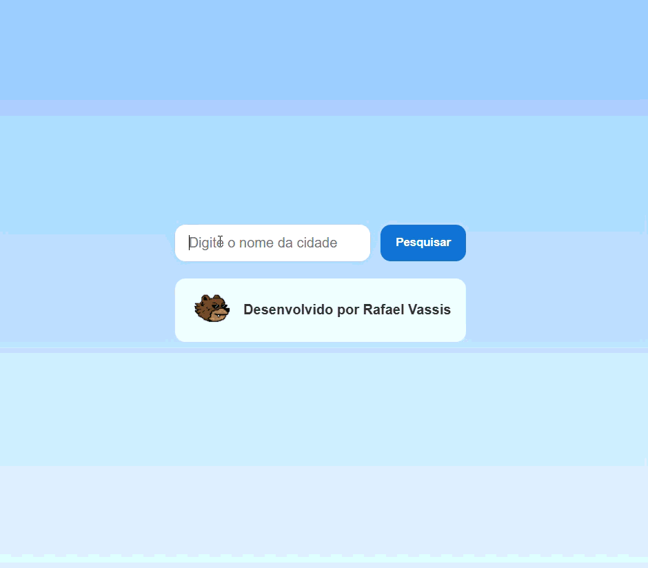

# 🌤️ Clima Agora

Aplicação web para consultar o clima atual de qualquer cidade, usando a API da OpenWeather.

🔗 **[Acesse o projeto online](https://clima-agora-seven.vercel.app/)**



---

## 🚀 Funcionalidades

- Busca por cidade (botão ou Enter)
- Temperatura, condição do tempo, umidade e velocidade do vento
- Ícone do clima atual
- Indicador de carregamento
- Tratamento de campo vazio, cidade inexistente e falha na API

---

## 🛠️ Stack

| Camada | Tecnologia |
| --- | --- |
| Interface | React 19 |
| Linguagem | TypeScript |
| Build | Vite |
| Estilos | CSS puro |
| Dados | OpenWeather API |
| Deploy | Vercel |

---

## 🏗️ Arquitetura

SPA sem backend: o navegador consulta a OpenWeather diretamente.

```text
src/
├── components/
│   ├── SearchBar/     # input + botão de busca
│   ├── WeatherCard/   # exibe os dados do clima
│   └── Credits/       # rodapé
├── types/Weather.ts   # tipagem da resposta da API
├── utils/             # funções auxiliares
├── styles/global.css
└── App.tsx            # estado (cidade, clima, loading, erro) e chamada à API
```

**Fluxo:** `SearchBar` → `App` (`fetch` à OpenWeather) → estado → `WeatherCard`.

O estado fica centralizado no `App`, e os componentes são apenas de apresentação, recebendo dados e callbacks por props.

---

## ▶️ Como executar

Requer Node.js.

```bash
git clone https://github.com/rafaelvassis/clima-agora.git
cd clima-agora
npm install
```

Crie um arquivo `.env` na raiz com a sua chave ([obtenha uma gratuita](https://openweathermap.org/api)):

```env
VITE_OPENWEATHER_API_KEY=sua_chave_aqui
```

```bash
npm run dev
```

---

## ☁️ Deploy

Hospedado na **Vercel**, com deploy automático a cada push na `main`.

- **Build:** `npm run build`
- **Saída:** `dist`
- **Variável de ambiente:** `VITE_OPENWEATHER_API_KEY`, configurada em *Project Settings → Environment Variables*

> ⚠️ Variáveis `VITE_*` são incluídas no bundle do front-end e ficam visíveis no navegador. Para um projeto de estudo isso é aceitável; em produção, o ideal é intermediar a chamada por uma função serverless.

---

## 📌 Próximos passos

- Geolocalização do usuário
- Previsão para os próximos dias
- Mínima, máxima e sensação térmica
- Alternância entre °C e °F

---

<p align="center">
  
</p>

<p align="center">
  <strong>Desenvolvido por Rafael Vassis</strong>
</p>
